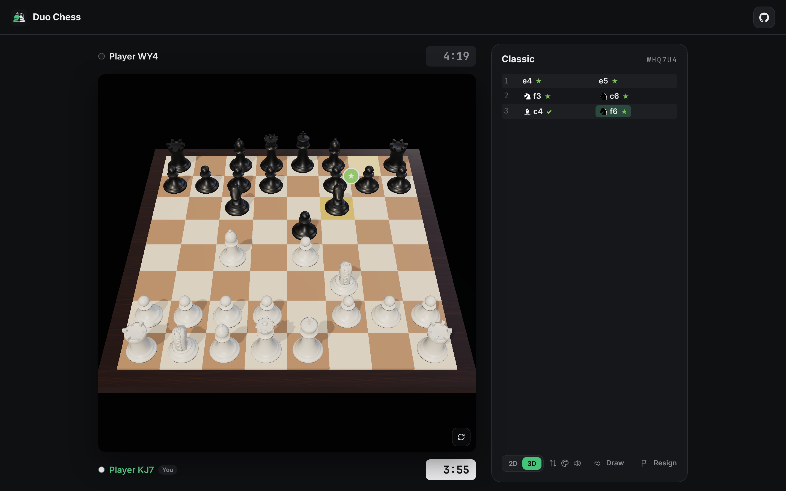
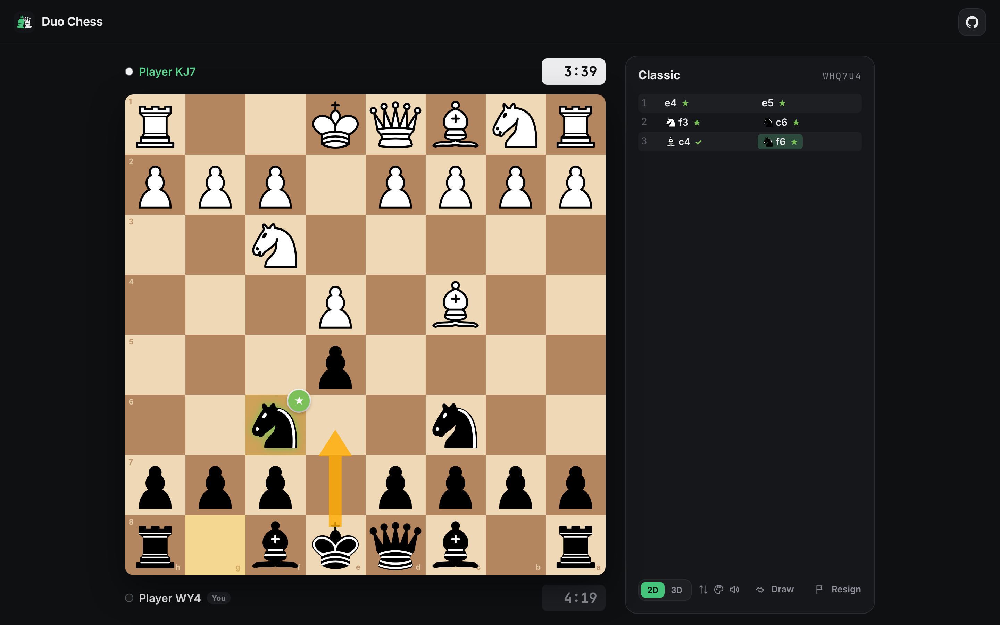
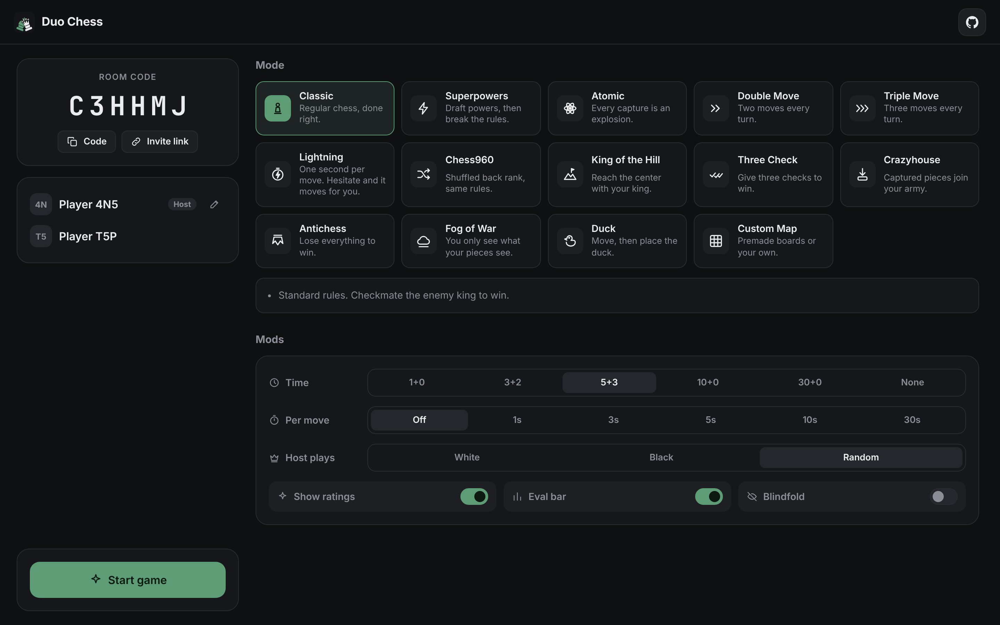
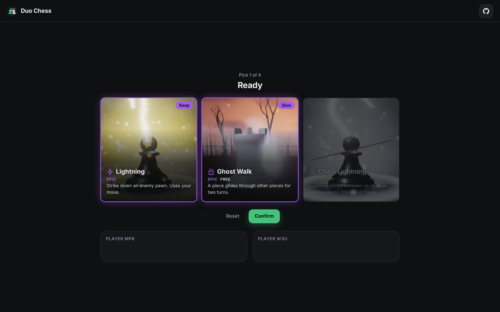
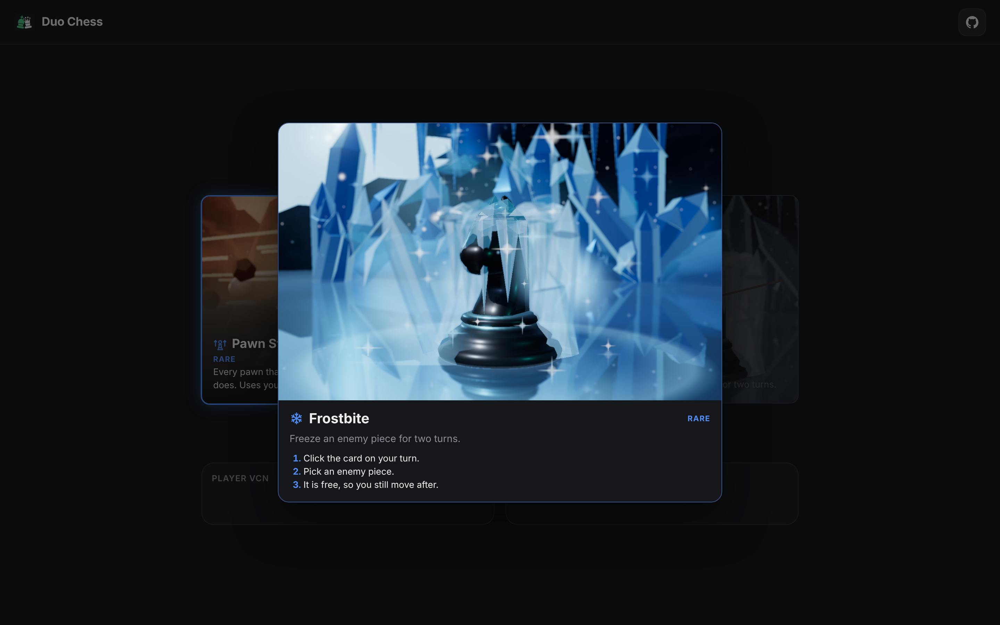
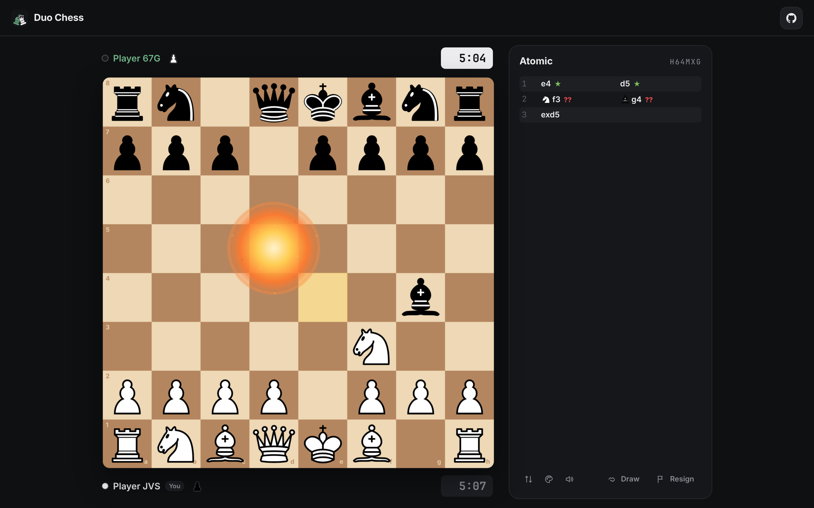
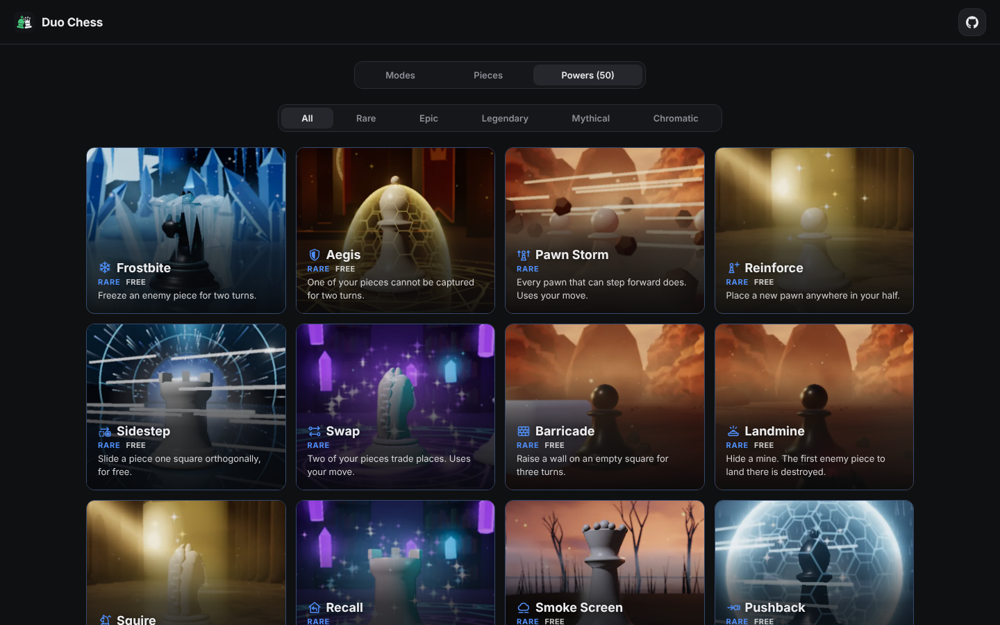
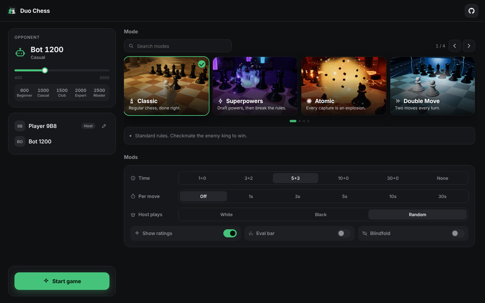

<p align="center">
  
</p>

<h1 align="center">Duo Chess</h1>

<p align="center">Two player online chess with wild game modes, 50 drafted superpowers and live move ratings.</p>

<p align="center">
  
  
  
</p>

## Screenshots


<table>
  <tr>
    <td></td>
    <td></td>
  </tr>
  <tr>
    <td></td>
    <td></td>
  </tr>
  <tr>
    <td></td>
    <td></td>
  </tr>
  <tr>
    <td></td>
    <td></td>
  </tr>
</table>

## What it is

Duo Chess is a quick, no account chess site for exactly two people. One person presses **Host game**, gets a six letter code, and the other person types it in. The host picks a mode and some mods, presses start, and you play. There are no ratings, no profiles and nothing stored long term. A room lives on the broker while you play and disappears afterwards.

No opponent around? **Play vs bot** works in every mode, with a strength slider from 400 to 3000 Elo.

Every game can be played on a flat 2D board or a full 3D board. Flip the **2D / 3D** switch in the game panel, drag empty space to orbit the camera, scroll to zoom and double click to reset the view. Both boards play the same real time 3D effects: atomic fireballs, lightning, pieces sealed in ice with icicles hanging off them, shield domes, portals and more.

### Game modes

| Mode | What changes |
| --- | --- |
| Classic | Regular chess. |
| Superpowers | Draft powers before the game, then fire one per turn. |
| Atomic | Every capture is an animated explosion. Blow up the king to win. |
| Double Move, Triple Move | Two or three moves per turn. Giving check ends your turn. |
| Lightning | One second per move, or a random move is played for you. |
| Chess960 | Shuffled back rank with proper 960 castling. |
| King of the Hill | Walk your king to the center to win. |
| Three Check | The third check wins. |
| Crazyhouse | Captured pieces go to your pocket and can be dropped back in. |
| Antichess | Captures are forced. Lose everything to win. |
| Fog of War | You only see what your pieces can reach. |
| Duck | After every move you place a duck that blocks a square. |
| Custom Map | Eleven premade boards or your own from the map editor. |

### Mods

Mods stack on top of any mode: a chess clock (bullet to classical, or none), a per move timer, **Show ratings**, an eval bar, blindfold, and which color the host plays.

### Board controls

The board behaves like the big chess sites. Click or drag to move. Right click a square to highlight it and right drag to draw an arrow (knight jumps bend into an L); hold Shift, Ctrl or Alt for green, blue or red. While your opponent thinks you can queue a premove, which plays the moment your turn comes if it is still legal. Click any move in the list, or use the arrow keys, to step back through the game; End returns to the live position.

### Move ratings

With **Show ratings** on, every move gets judged live: Legendary, Brilliant, Great, Best, Excellent, Good, Inaccuracy, Mistake or Blunder. The piece that moved lights up in the rating color. Brilliant, Great and Legendary moves shine, pop and wobble, a Legendary move also throws golden rays, and mistakes and blunders glow red and shake. Each rating has its own sound.

### Superpowers

There are 50 powers across five rarities: 15 rare, 12 epic, 10 legendary, 8 mythical and 5 chromatic (which cycle through the rainbow). Before the game you draft in turns. Each pick shows three rolled powers: keep one, give one to your opponent, and the last one gets crossed out. In game you can fire one power per turn. Some are free (Frostbite, Aegis, Double Down), others use up your move (Meteor, Teleport, Black Hole). Every power has its own line icon, board effect and sound. Its card shows a cinematic render of the power in a world that fits it (Frostbite freezes a knight in an ice cave, Meteor lands in a volcano), and resting on a card for three seconds plays it live in 3D with how to use it.

### Fairy pieces and maps

Sixteen extra pieces are drawn in the same style as the classic set: Archbishop, Chancellor, Amazon, Dragon, Rail, Camel, Zebra, Nightrider, Cannon, Grasshopper, Wizard, Champion, Centaur, Mann, Bomb and Phoenix, plus the Duck. The Library page shows each one with a movement diagram generated from the real move rules. The map editor lets you paint boards from 6x6 to 10x10, punch holes, and mirror one side onto the other so you only build half.

## How it works

### Realtime without a server

Vercel functions cannot hold WebSocket connections, so the app does not try to. Each room is its own channel on a public MQTT broker, reached from the browser over secure WebSockets.

1. The host's browser owns the room. It keeps the authoritative `RoomState` and publishes it as a **retained** message on `duochess/v1/room/<CODE>/state`. Retained means the broker keeps the latest copy, which acts as the room's short lived database. Anyone who subscribes gets it right away, and a refreshing host resumes from it.
2. Guests never change state directly. They publish actions (join, move, power, draft pick, resign) to `.../action`. The host runs them through a pure reducer, validates them with the rules engine, and publishes the new state.
3. Snapshots are sent with an MQTT 5 expiry of six hours, and closing a room publishes an empty retained message, so finished games delete themselves.
4. Presence uses retained flags plus an MQTT last will, so a closed tab shows up as away.

This is deliberately not secure. Anyone with a code could join or read a room, which is fine for a game played for fun.

### Rules engine

`src/engine` is plain TypeScript with no React. Pieces are declared as movement patterns (leap, slide, fly, hop, cannon), so the generator handles every fairy piece without special cases. Modes are just combinations of rule switches: atomic explosions, forced captures, drops, multi move turns, king of the hill, check counting and the duck. The generator passes the standard perft suites (start position, Kiwipete, positions 3, 4 and 5).

### Move analysis

The host rates each move and broadcasts the result, so both players see the same badge.

- Standard rule modes (Classic, Lightning, Chess960) use **Stockfish 19** compiled to WebAssembly, running in a Web Worker. The wasm build is copied from `node_modules` into `public/engine` at build time.
- Every other mode uses a built in alpha beta search with quiescence that runs the exact same rules engine, also in a worker.

Scores become win chances, and the rating comes from how much win chance the move threw away compared to the best move. A best move that sacrifices material is Brilliant. A move that wins on the spot is Legendary.

### 3D, rendered art and the landing page

Everything 3D is plain three.js, written in `src/three`.

- **Pieces** are modelled in code: the classics are turned on a lathe, and the knight family, dragon, rail, cannon, wizard, phoenix and the rest are sculpted from lathes, tubes and bevelled extrusions.
- **Effects** live in `src/three/fx` and work in a frame where one square is one unit, so the same explosion runs on the 3D board, on top of the 2D board and in the rendered previews.
- **Worlds** in `src/three/env` (ice cave, volcano, storm, void, temple, grass battlefield and more) frame the mode clips and power art.
- **The landing page** runs a live battle on a grass plain behind the home screen, with pieces blasted toward the camera.

Mode clips and power cards are rendered offline from the same scenes, so they always match the game. `scripts/render-media.cjs` steps each scene frame by frame in headless Chromium and encodes WebM loops and WebP stills into `public/media`.

### Sound

Every sound is synthesized with the Web Audio API, so there are no audio files to load.

## Getting started

You need Node 20 or newer.

```bash
npm install
```

```bash
npm run dev
```

Open http://localhost:3000, press **Host game**, and open the room link in a second tab to play yourself.

By default the app talks to the public broker at `wss://broker.emqx.io:8084/mqtt`. To work fully offline, start the bundled local broker and point the app at it. The local broker only speaks MQTT 3.1.1, so set the protocol too.

```bash
npm run broker
```

```bash
NEXT_PUBLIC_MQTT_URL=ws://localhost:8883 NEXT_PUBLIC_MQTT_PROTOCOL=4 npm run dev
```

### Deploy

Push the repo to GitHub and import it in Vercel. No environment variables or databases are needed. To use your own broker, set `NEXT_PUBLIC_MQTT_URL` in the Vercel project settings.

## Testing

```bash
npm test
```

The unit suite covers perft, every rule variant, all 50 powers and the draft, the room reducer (clocks, flags, move timer, rematch), the search and the move classifier.

The end to end scripts drive two real browsers through the local broker. Start `npm run broker` and the dev server with the local broker settings on port 3100, then run any of these.

```bash
node tests/e2e/play.cjs
```

```bash
MODE=atomic MOVES="g1f3 d7d5 f3e5 d8d6 e5f7" RESULT=1 node tests/e2e/play.cjs
```

```bash
node tests/e2e/superpowers.cjs
```

`tests/e2e/board.cjs` covers arrows, premoves and history, `tests/e2e/board3d.cjs` plays a game by clicking squares on the 3D board, and `tests/e2e/bot.cjs` plays the bot. `tests/e2e/screenshots.cjs` regenerates the images in this README.

To re-render the mode clips and power art after changing a scene, run a dev server on port 3110 and then the media script.

```bash
NEXT_DIST_DIR=.next-media npx next dev -p 3110
```

```bash
node scripts/render-media.cjs all
```

## Project structure

```
src/
  app/                 Next.js routes: home, room, editor, library
  engine/              Rules engine: pieces, move generation, outcomes, notation
  features/
    analysis/          Stockfish client, built in search, rating logic
    bot/               Bot brain, Elo mapping, duck and power choices
    audio/             Synthesized sound effects
    maps/              Map format, premade maps, local storage
    modes/             Mode catalog, mods, game builder
    net/               MQTT channel and room codes
    powers/            50 powers, targeting, activation, draft, icons
    room/              Room state, host reducer, clocks, online and local rooms
  three/
    pieces/            3D piece models
    fx/                3D effects
    env/               Cinematic worlds
    board3d/           The 3D game board
    overlay/           3D effects over the 2D board
    scenes/            Mode clips, power shots, landing battle
  components/
    board/             2D board, arrows, premoves, effects layer
    board3d/           3D board component and input
    game/              Game screen panels
    lobby/             Lobby, mode grid, mods, map picker
    bot/, editor/, library/, home/, room/, three/, ui/
public/pieces/         2D piece artwork
public/media/          Rendered mode clips and power art
tests/unit/            Vitest suites
tests/e2e/             Two browser Playwright scripts
```

## Credits

The classic pieces are the Cburnett set, used under its BSD license. Move ratings for standard games come from [Stockfish](https://stockfishchess.org) via [stockfish.js](https://github.com/nmrugg/stockfish.js) (GPLv3), which is loaded as a separate worker file and is not part of this repository's source. Everything else is MIT licensed.
